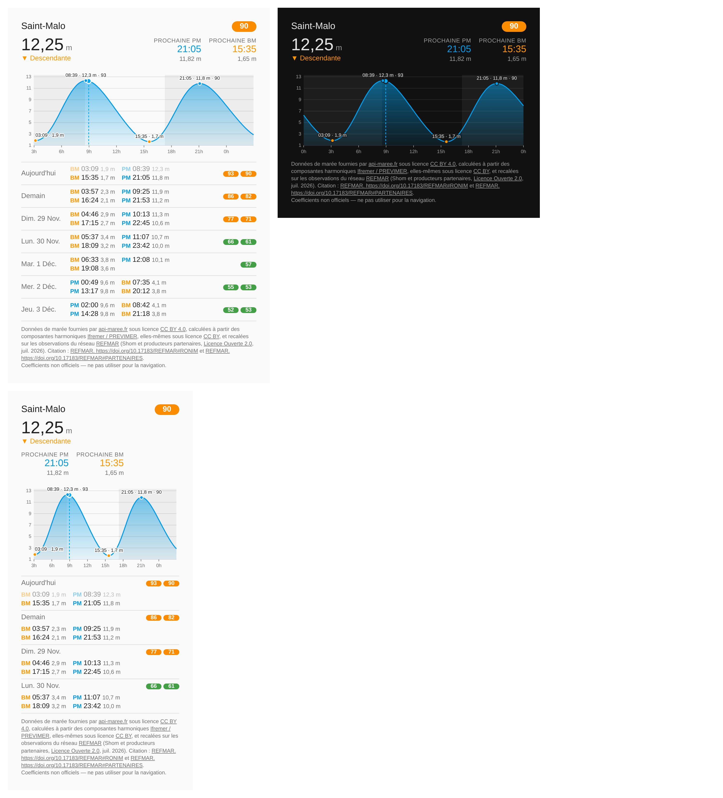
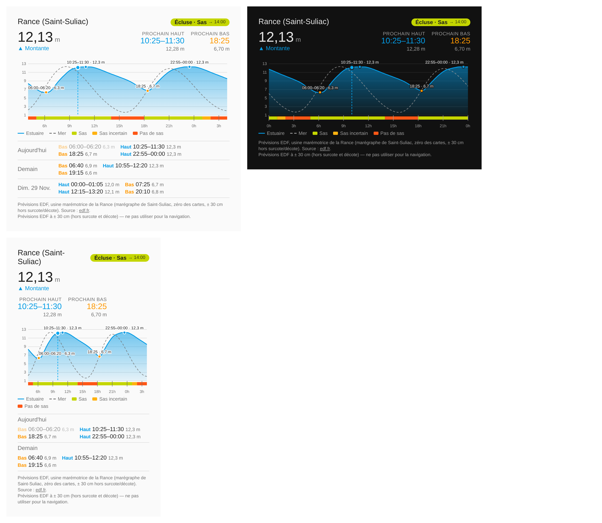

# API Marée Card

Carte Lovelace pour l'intégration Home Assistant
[API Marée](https://github.com/kekus22/ha-api-maree) (données [api-maree.fr](https://api-maree.fr/)).



- Hauteur d'eau actuelle, marée montante / descendante, prochaines pleine et basse mers.
- **Courbe de marée** avec curseur « maintenant », pleines et basses mers annotées (heure, hauteur,
  coefficient), fond jour / nuit et infobulle au survol.
- **Mode complet** : tableau des prochains jours avec les coefficients (couleur selon l'amplitude).
- Thème clair / sombre de Home Assistant, français et anglais, éditeur visuel, compatible avec les
  sections.
- Aucune dépendance externe, aucun appel réseau : la carte lit uniquement les attributs de l'entité.

### Estuaire de la Rance (source EDF)

Avec l'entité *Hauteur d'eau* de la source **Estuaire de la Rance (EDF)**, la carte affiche en plus :

- la **courbe de la mer** en pointillé, à comparer au niveau de l'estuaire ;
- le **bandeau de l'écluse** sous la courbe (sas, sas à la demande, sas incertain, pas de sas) et le
  statut actuel dans l'en-tête ;
- les **paliers** des niveaux hauts et bas (par exemple « 10:25–11:30 · 12,3 m »).



Options propres à cette source : `show_sea` et `show_locks` (activées par défaut).

## Prérequis

L'intégration [API Marée](https://github.com/kekus22/ha-api-maree) installée et configurée.

## Installation

### HACS

1. HACS → menu ⋮ → *Dépôts personnalisés* → ajouter `https://github.com/kekus22/ha-api-maree-card`,
   catégorie **Tableau de bord** (*Dashboard*).
2. Installer **API Marée Card**, puis recharger le navigateur.

### Manuelle

1. Copier `api-maree-card.js` dans `config/www/`.
2. *Paramètres → Tableaux de bord → ⋮ → Ressources* → ajouter `/local/api-maree-card.js`
   (type *Module JavaScript*).

## Utilisation

Ajouter une carte → **API Marée**, puis choisir l'entité *Hauteur d'eau* du port. Tout se règle dans
l'éditeur visuel. En YAML :

```yaml
type: custom:api-maree-card
entity: sensor.maree_saint_malo_hauteur_d_eau
mode: full          # chart (courbe seule) ou full (courbe + tableau)
window: rolling     # rolling (glissante autour de maintenant) ou day (00 h – 24 h)
hours: 24           # durée de la fenêtre glissante (12 à 48)
days: 7             # jours affichés dans le tableau (mode full)
show_sun: true      # fond jour / nuit
show_attribution: true
title: Saint-Malo   # facultatif
```

| Option | Défaut | Description |
|---|---|---|
| `entity` | — | **obligatoire** — capteur *Hauteur d'eau* de l'intégration |
| `mode` | `chart` | `chart` ou `full` |
| `window` | `rolling` | `rolling` : de −¼ à +¾ de la durée autour de maintenant ; `day` : journée en cours |
| `hours` | `24` | durée de la fenêtre glissante |
| `days` | `7` | nombre de jours du tableau (1 à 7) |
| `show_sun` | `true` | assombrit les heures de nuit |
| `show_attribution` | `true` | affiche la mention de la source |
| `show_sea` | `true` | Rance : courbe du niveau de la mer |
| `show_locks` | `true` | Rance : horaires de l'écluse |
| `title` | nom du port | titre de la carte |

### Couleurs

Personnalisables via [card-mod](https://github.com/thomasloven/lovelace-card-mod) ou un thème :

```yaml
api-maree-water-color: "#1e88e5"
api-maree-high-color: "#1e88e5"
api-maree-low-color: "#fb8c00"
```

## Licence des données

Les données sont publiées par api-maree.fr sous licence **CC BY 4.0** : la mention de la source,
avec ses liens, doit rester visible quand les données sont affichées. C'est pourquoi l'option
`show_attribution` est activée par défaut. Les coefficients sont des valeurs non officielles : ne
pas utiliser pour la navigation.

Code sous licence MIT.
